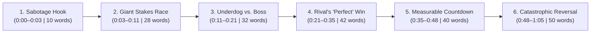

# Viral Short Duplication Formula: The "Counter-Intuitive Engineering Parable"

Based on the frame-by-frame breakdown of **"Why Perfect Railroads Don't Work"** (`65.2s`, `202 words`, `26 shots`), here is the exact mathematical, narrative, and visual formula to duplicate this format for any engineering, physics, or historical topic.

---

## 1. The Quantitative Pacing Formula

| Metric | Exact Target | Why It Works |
| :--- | :--- | :--- |
| **Total Duration** | `60 – 65 seconds` | Long enough for YouTube Shorts high-retention monetization boost, short enough for near-100% average view duration (AVD). |
| **Word Count & WPM** | `195 – 210 words` (`~185 WPM`) | Zero dead air; sentences chain together with connectors (*"You see," "And when," "But," "Then," "Meanwhile"*). |
| **Average Shot Length (ASL)** | `2.5 seconds` (`25–28 cuts` per minute) | Visuals change before the viewer's brain can register boredom; hook (`00:00–00:04`) and climax (`01:00–01:05`) cut every `1.0–1.5 seconds`. |
| **On-Screen Captions** | `1 – 3 words` per burst | Centered at `Y = 70%` (lower-middle safe zone, above YouTube UI), bold white sans-serif (*Montserrat Black* / *The Bold Font*) with a thick black outline (`8–12 px`). |
| **Loop Cut** | Final frame lasts `0.4s` | The explosion/payoff flashes for less than half a second on the final word, forcing viewers to rewatch or seamlessly loop back to `00:00`. |

---

## 2. The 6-Beat Narrative Formula (With Exact Word & Time Budgets)



### Beat-by-Beat Script Template

1. **Beat 1 — The "Sabotage" Hook (`00:00 – 00:03` | ~10 words)**
   - **Rule:** Open *in media res* with the protagonist deliberately doing a seemingly destructive act involving a **hyper-specific number**.
   - **Original:** *"He sawed gaps into a railroad every 39 feet."*
   - **Formula:** `"He [destructive verb] [flaw] into a [massive structure] every [exact number] [unit]."`

2. **Beat 2 — The Binary Race & Ultimate Prize (`00:03 – 00:11` | ~28 words)**
   - **Rule:** Immediately pivot with *"You see, two companies are racing to..."* across an exaggerated geographical obstacle for a winner-take-all prize.
   - **Original:** *"You see, two companies are racing to build a railroad through a canyon so deep you can't see the bottom. And whoever finishes first gets the whole country's business."*
   - **Formula:** `"You see, two [rivals] are racing to build a [structure] across a [extreme hazard]. And whoever finishes first gets [the ultimate prize]."`

3. **Beat 3 — The Young Underdog vs. The Purple Boss (`00:11 – 00:21` | ~32 words)**
   - **Rule:** Make the protagonist the youngest/lowest-ranked person on the crew. Have an authority figure discover the "flaw," turn purple with rage, and demand it be fixed—while the protagonist calmly refuses.
   - **Original:** *"He's the youngest engineer on the job. And when his boss sees the finger-wide gap between every single rail, he goes purple: 'You're wrecking my railroad!' But he won't close a single one."*
   - **Formula:** `"He's the youngest [role] on the job. And when his boss sees the [physical scale of flaw], he goes purple: 'You're wrecking my [project]!' But he refuses to change a single one."`

4. **Beat 4 — The Rival's "Perfect" Shortcut & Public Humiliation (`00:21 – 00:35` | ~42 words)**
   - **Rule:** Show the rival doing the intuitive, "flawless" version and winning early praise, while the protagonist's project is mocked with a catchy newspaper nickname.
   - **Original:** *"The other company lays their rails with no gaps, perfectly smooth, and finishes first. Their trains glide across the canyon without a sound, while his go clickety-clack over every gap. The newspapers call it 'The Clickety Clack Line,' and everyone switches to the quiet trains."*
   - **Formula:** `"The other company builds theirs [without the flaw], perfectly [adjective], and finishes first. Their [system] works [flawlessly], while his [suffers annoying side effect]. The newspapers call it '[Mocking Nickname],' and everyone switches."`

5. **Beat 5 — The Seasonal/Time Trigger & Tangible Yardsticks (`00:35 – 00:48` | ~40 words)**
   - **Rule:** Introduce an environmental shift (summer heat, winter freeze, storm, load test). Measure the change using **everyday objects** (`a coin`, `a sheet of paper`), while the boss arrogantly misinterprets the change.
   - **Original:** *"Then summer comes, and something weird happens. His gaps start shrinking. In May, a coin still fits. By July, barely a sheet of paper. And his boss is thrilled: 'See, even your gaps know you were wrong!'"*
   - **Formula:** `"Then [season/condition] comes, and something weird happens. His [flaw] starts [changing]. In [Month 1], a [object A] still fits. By [Month 2], barely a [object B]. And his boss is thrilled: 'See, even your [flaw] knows you were wrong!'"`

6. **Beat 6 — The Physics Climax & Cliffhanger Disaster (`00:48 – 01:05` | ~50 words)**
   - **Rule:** Cross-cut (`"Meanwhile, on the perfect..."`) to show invisible physical forces building up in the rival's rigid structure until the peak day arrives, the protagonist's "flaw" saves his design, and the rival's "perfect" structure fails catastrophically on the very last word.
   - **Original:** *"Meanwhile, on the perfect line, the rails groan in the afternoon sun, pushing against each other like they want to break free. On the hottest day anyone can remember, his gaps finally close, rail touching rail. And halfway across the canyon, the perfect track kicks out to the side like a snake, right as a train rolls onto it."*
   - **Formula:** `"Meanwhile, on the perfect [structure], the [parts] groan under [force], pushing like they want to break free. On the [most extreme] day anyone can remember, his [flaw] finally [reaches equilibrium]. And halfway across the [hazard], the perfect [structure] [violent simile], right as [catastrophic trigger]."`

---

## 3. The Visual Style Formula ("2D Stick-Puppet in a 3D Stylized World")

What makes this channel visually distinct is the **hybrid contrast** between flat 2D cartoon characters and a cinematic 3D environment:

### A. Character Design Rules (Keep 100% Consistent Across Shots)
- **Head:** Pure white circle (`#FFFFFF`) with a thick black ink outline, flat 2D facial features (expressive eyebrows, simple oval/circle eyes, no nose).
- **Body:** Pill/bean-shaped torso with thin black stick arms and legs.
- **Archetype Costumes (Color-Coded for Instant Readability):**
  1. **The Young Engineer (Hero):** Teal/green overalls, red-and-white polka-dot bandana, blue-and-white striped train engineer cap.
  2. **The Boss (Skeptic):** Mustard-yellow waistcoat with gold buttons and pocket-watch chain, white dress shirt, black bowtie, black bowler hat, walking cane.
  3. **The Rival Tycoon (Antagonist):** Black Victorian suit, gold chain, tall black top hat with gold ribbon.

### B. 3D Environment & Camera Rules
- **Color Palette:** High-saturation warm terracotta oranges/reds (`#D9532F`) against deep ultramarine canyon blues (`#234099`) for maximum complementary color contrast on mobile screens.
- **Visualizing Invisible Forces:** Whenever heat, pressure, or tension is mentioned in the script, **color-shift the 3D material** using a thermal gradient (`purple` → `orange` → `glowing yellow-white`) and add flying sparks or popping bolts.
- **Readable Diegetic Props:** Insert 2–3 close-up shots with readable English text on props to reward attentive viewers and boost pause-rate:
  - Station banner: `"FIRST LINE IN GETS IT ALL!"`
  - Newspaper front page: `"THE CLICKETY CLACK LINE!"`
  - Calendar flipping: `"MAY"` → `"JULY"`
  - Stenciled measurement on tie: `"39 FT"`

---

## 4. Copy-Paste Prompts to Generate Your Own Episode

### Step 1: Master Script Generator Prompt (Paste into ChatGPT / Claude / Gemini)

```text
Write a 65-second YouTube Short script (strictly 195–205 words) in the exact narrative style of "Why Perfect Railroads Don't Work" for the following engineering concept: [INSERT TOPIC, e.g., "Why Skyscrapers Have a Giant 730-Ton Pendulum Ball at the Top" or "Why Airplane Wings Are Built to Bend 20 Feet Upward"].

Follow this exact 6-beat structure and word budget:
1. Hook (10 words): Start with "He [did something that looks like sabotage with a specific number]..."
2. Stakes (28 words): "You see, two companies are racing to..." across an extreme environment where whoever finishes first gets the whole country's business.
3. Conflict (32 words): He's the youngest engineer on the job. When his boss sees the "flaw", his face turns purple ("You're wrecking my [project]!"), but the engineer refuses to remove it.
4. False Defeat (42 words): The rival company builds theirs "perfectly" (rigid/flawless) and finishes first. Theirs is smooth/quiet while his has an annoying quirk. Newspapers mock his with a catchy nickname, and everyone switches to the rival.
5. Physical Progression (40 words): A seasonal change arrives. Use two everyday objects (like a coin, a sheet of paper, a coffee cup) to measure his design changing over two specific months, while his boss gloats: "See, even your [flaw] knows you were wrong!"
6. Climax & Cliffhanger (50 words): "Meanwhile, on the perfect..." show the hidden physical stress building up. On the most extreme day in memory, his design reaches perfect equilibrium, while the rival's "perfect" structure fails catastrophically right as it is in use. End on the exact moment of impact.

Output:
1. The raw voiceover script (195–205 words, 5th-grade reading level, punchy rhythm).
2. A 26-shot storyboard table with timestamps (00:00 to 01:05), image generation prompts, and motion prompts.
```

### Step 2: Master Visual Style Prompt (Midjourney / Flux / Image-to-Video)

Use this base style prompt for every keyframe before animating in **Kling / Runway Gen-3 / Veo**:

```text
Vertical 9:16 frame, hybrid 2D-3D animation style. A flat 2D cartoon stick-figure character with a round white head, thick black outline, simple expressive 2D eyes and mouth, wearing [COSTUME], composited inside a stylized cinematic 3D [ENVIRONMENT] with rich Pixar/Team Fortress 2 lighting, vibrant orange and deep blue color contrast, dramatic wide-angle perspective, depth of field.
```

### Step 3: Audio & Editing Assembly Checklist (CapCut / Premiere Pro)
1. **Voiceover:** Generate with a storytelling baritone voice at `1.10x–1.15x` speed, stripping all pauses longer than `0.15s` between sentences.
2. **Background Music:** Tense, rhythmic pizzicato strings / Western acoustic build-up at `-18 dB` that swells at `00:48` (*"Meanwhile..."*) and cuts out completely at `01:02` right before the crash.
3. **Sound Effects (SFX Every 2 Seconds):**
   - `00:00`: Metallic hacksaw rasping + steam train whistle
   - `00:08`: Wind howling + falling pickaxe whistle
   - `00:18`: Tea-kettle steam whistle when the boss turns purple
   - `00:29`: Loud rhythmic *clickety-clack* + ceramic mug splash
   - `00:50`: Deep metallic groaning / submarine hull creak + pinging bolts
   - `01:02`: Violent metal snapping + explosion boom at `01:04.8`

